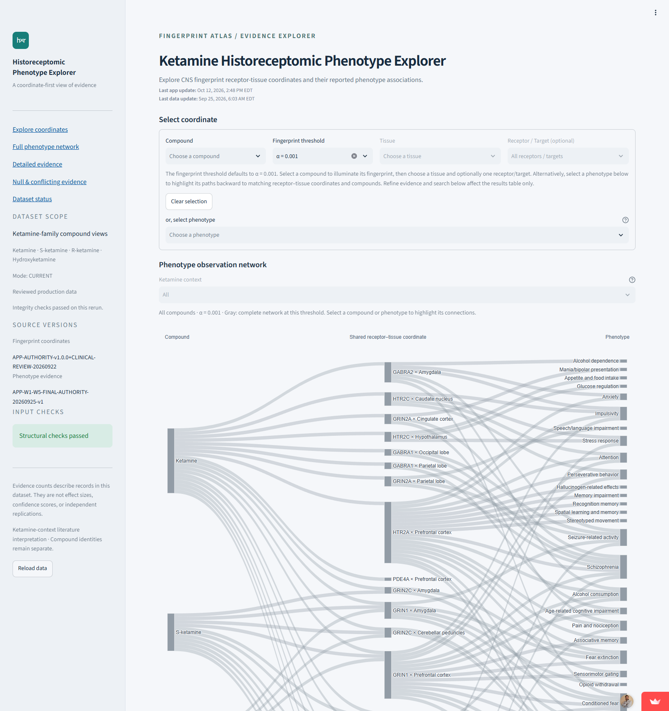
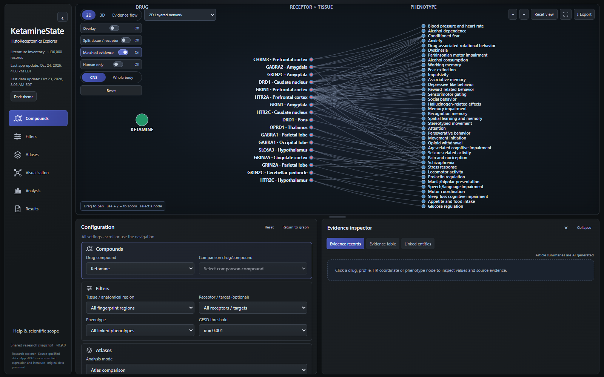
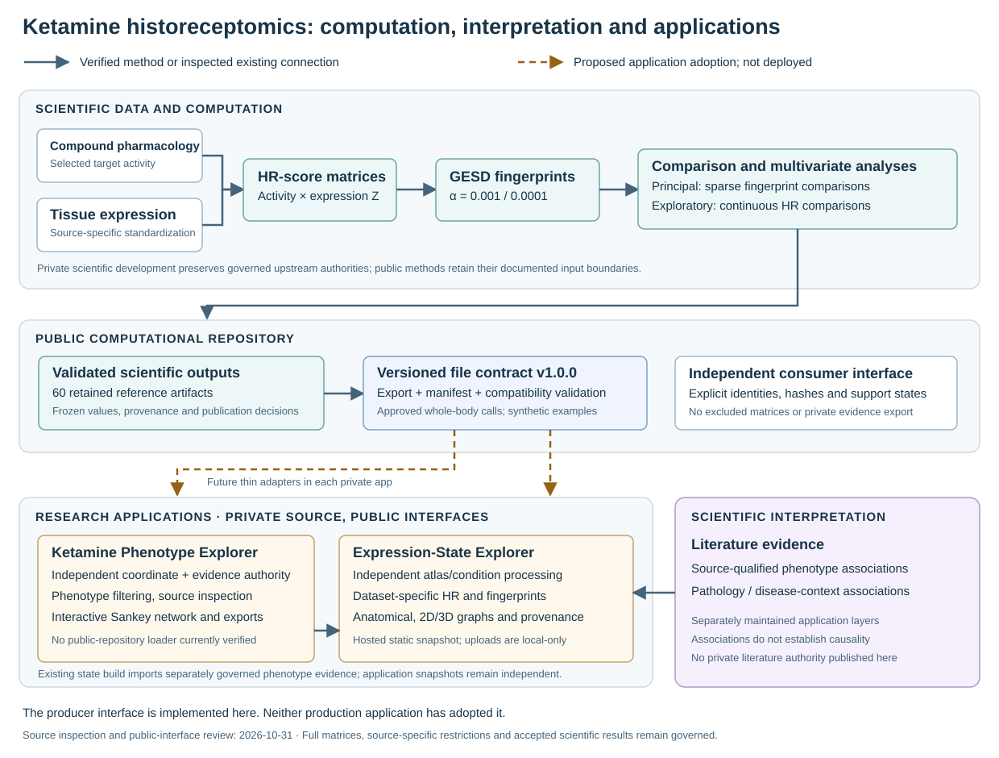

# Ketamine Historeceptomics

[](https://github.com/ericrosenn1/ketamine-historeceptomics/actions/workflows/ci.yml)
[](https://ericrosenn1.github.io/ketamine-historeceptomics/)
[](https://github.com/ericrosenn1/ketamine-historeceptomics/releases/latest)
[](LICENSE)
[](CITATION.cff)

Ketamine Historeceptomics combines compound–target pharmacological activity with human tissue expression to investigate target–anatomy relationships for ketamine, its enantiomers and metabolites, and 25 psychoactive reference drugs. The research asks how their historeceptomic fingerprints overlap and differ across CNS and whole-body analysis scopes.

This is the public computational research repository for the larger Cardozo ketamine historeceptomics project. It provides scientific methods, reproducibility software, selected accepted numerical results, and a versioned file interface for downstream applications. It accompanies the working manuscript **_Historeceptomic Profiling of Ketamine, Its Enantiomers, and Metabolites_** by **Eric Rosenn and Timothy Cardozo**.

## Computational approach

**HR score = target-level pharmacological activity × standardized tissue expression**

Activity is expressed as the governed target-level pActivity value or numerical censoring boundary; expression is standardized within each gene using sample standard deviation (`ddof=1`). The **HR-score matrix** is the complete numerical representation of HR values at supported target-anatomy coordinates. Unsupported coordinates remain missing.

A **historeceptomic fingerprint (HR fingerprint)** is the sparse set of target-anatomy coordinates selected from the HR-score matrix as upper-tail outliers using the project's one-sided generalized extreme Studentized deviate (**GESD**) implementation. A fingerprint is distinct from the complete HR-score matrix.

The primary fingerprint threshold is **α = 0.001**. The more stringent sensitivity threshold is **α = 0.0001**.

A **fingerprint-call matrix** encodes membership: **1 means called**, **0 means tested non-call**, and **missing means unsupported or untested**. It is distinct from an HR-score matrix.

**Fingerprint comparisons are the principal analytical results.** Continuous common-RHR comparisons are exploratory. Methods include call overlap, Jaccard similarity, overlap coefficient, signed sparse cosine, fingerprint PCA, and exploratory continuous PCA, PCoA, MDS, clustering and correlations. See [computational methods](docs/METHODS.md).

## Interactive Research Applications

These separately developed research applications extend the computational analysis into interactive exploration. Their production source repositories are currently private; their public interfaces can be launched below. Additional expression, evidence, literature and visualization processing is maintained separately.

### Ketamine Phenotype Explorer

[**Launch the Phenotype Explorer →**](https://ketamine-phenotype-explorer.streamlit.app/)



Explore compound-specific fingerprints and receptor–tissue–phenotype associations across four compound views, inspect literature evidence and source records, filter phenotypes, interact with Sankey/network views, and download selected data. The app reads its own pinned coordinate and phenotype-evidence authority.

### Expression-State Historeceptomics Explorer

[**Launch the Expression-State Explorer →**](https://huggingface.co/spaces/EricRosenn1/ketamine-state-historeceptomics)



Select expression atlases, explore dataset-specific recalculated fingerprints and supported biological-condition comparisons, inspect receptor–tissue and phenotype graphs, and use anatomical and 2D/3D representations, provenance tables and comparison tools. The public Space serves a packaged research snapshot; expression uploads and local recomputation belong to its local application.

The screenshots are genuine public-interface captures from **2026-10-31**; [capture provenance and scope](docs/figures/apps/README.md) are recorded. The state screenshot's **17 displayed evidence-linked coordinates** are a filtered graph subset, not a revision of the accepted **19 CNS calls**. Features and current data flows are documented in the [integration assessment](audits/PROJECT_INTEGRATION_ASSESSMENT.md).

## Scientific analyses and selected results

Accepted **v0.1.1** reference results are preserved. Here, **Ketamine** denotes the pooled-parent analysis profile, separately retained from confirmed racemate. Enantiomers, specified metabolite stereoisomers, unspecified-isomer aggregates and generic profiles remain distinct.

| Analysis | Accepted scope or result |
|---|---|
| Strict-CNS Ketamine HR-score matrix | 58 targets × 18 tissues = 1,044 coordinates |
| Strict-CNS fingerprint | 19 primary calls; 14 sensitivity calls |
| Whole-body Ketamine HR-score matrix | 58 targets × 77 tissues = 4,466 coordinates |
| Whole-body fingerprint | 59 primary calls; 38 sensitivity calls |
| Ketamine-family comparison | 10 profiles; 45 unordered pairs |
| External reference panel / combined comparison | 25 external profiles / 35 profiles; 595 unordered pairs |
| S-ketamine vs R-ketamine, α = 0.001 | 11 shared calls; 12-call union; Jaccard 0.92; overlap coefficient 1.00 |
| Family fingerprint PCA, α = 0.001 | 17 variable features; PC1 68.2%; PC2 30.4% |
| Global fingerprint PCA, α = 0.001 | 30 variable features; PC1 51.0%; PC2 44.5% |

The [three-figure results gallery](docs/RESULTS_GALLERY.md) provides captions, exact source tables, hashes, selections and limitations. The first two views directly display accepted table values; Figure 4 is unchanged.

| Whole-body fingerprint | Family fingerprint comparison | External-drug context |
|---|---|---|
|  |  |  |
| [Stored HR values, ranks 1–12 of 59](results/reference/whole_body/KETAMINE_WHOLE_BODY_FINGERPRINT_ALPHA_0p001.csv); α = 0.001 | [All 45 stored Jaccard values](results/reference/family/KETAMINE_FAMILY_ALL_PAIR_METRICS_FINAL.csv); α = 0.001; stars mark empty-union conventions | [Frozen continuous PCA coordinates](results/reference/figure4/source_data/VALIDATED_FIGURE4_SOURCE_COORDINATES.csv); exploratory; no GESD α; nonconverged fit limitation retained |

Literature-based CNS phenotype and neuropsychiatric pathology interpretation is documented separately from the executable public reproduction workflow; see [optional analyses](optional/README.md) and the [reproducibility matrix](ANALYSIS_REPRODUCIBILITY_MATRIX.csv).

## Project architecture and data flow



The project consists of this public computational repository, a private scientific development repository, and the two independently maintained applications. The diagram distinguishes verified computation/build connections from proposed application adoption of the new interface. Scientific interpretation and application-specific processing retain their own provenance and governance.

The public producer and validator below are implemented and tested. **Neither production application currently consumes this export contract.** Compatible selected coordinates do not establish shared files, byte-identical matrices, or one automated production pipeline. See [application integration](docs/APPLICATION_INTEGRATION.md) for verified relationships, consumer responsibilities and future adapter tasks. Repository visibility governs code access; compatible data contracts enable exchange without requiring public application source.

## Reproducibility and data availability

The public release retains **60 scientific reference artifacts** and a class-membership registry. **Twenty near-source numerical inputs are excluded** because redistribution terms are source-specific or unclear. Their required paths, sizes and SHA-256 values are in [EXTERNAL_INPUT_MANIFEST.tsv](EXTERNAL_INPUT_MANIFEST.tsv); acquisition and usage constraints are in [data sources](docs/DATA_SOURCES.md) and [provenance](docs/PROVENANCE.md).

- **Smoke:** self-contained software validation with invented fixtures; no restricted inputs.
- **Verify:** requires a separately obtained, manifest-valid external input tree.
- **Full:** requires that tree plus the documented initial activity table and historical resources; it does not claim reconstruction from raw public databases through the unrecovered earliest activity-table producer.

Follow the [reproducibility guide](docs/REPRODUCIBILITY.md) and [Full-mode boundary](docs/FULL_MODE.md). The [reference checksum record](audits/INTEGRATION_REFERENCE_CHECKSUMS.tsv) and [integration regression audit](audits/INTEGRATION_REGRESSION_AUDIT.md) document preservation and validation of this enhancement. Software execution, byte identity and scientific validity are distinct checks.

## Quick start

The validated environment is **Python 3.12, Windows and PowerShell 7**. From PowerShell:

```powershell
$ErrorActionPreference = 'Stop'
git clone https://github.com/ericrosenn1/ketamine-historeceptomics.git
if ($LASTEXITCODE -ne 0) { throw 'Clone failed' }
Set-Location ketamine-historeceptomics
py -3.12 -m venv .venv
if ($LASTEXITCODE -ne 0) { throw 'Environment creation failed' }
$env:CARDOZO_HR_PYTHON = (Resolve-Path .\.venv\Scripts\python.exe).Path
& $env:CARDOZO_HR_PYTHON -m pip install -r requirements-lock.txt
if ($LASTEXITCODE -ne 0) { throw 'Dependency installation failed' }
& $env:CARDOZO_HR_PYTHON -m pip install --no-deps --no-build-isolation -e .
if ($LASTEXITCODE -ne 0) { throw 'Package installation failed' }
pwsh -NoProfile -File .\launchers\Smoke.ps1
if ($LASTEXITCODE -ne 0) { throw 'Smoke validation failed' }
```

Smoke uses synthetic data; its success does not reproduce the ketamine reference analysis. Additional platforms and execution requirements are described in the [environment guide](docs/ENVIRONMENT.md).

### Export approved results for an application

With the installed environment selected as `python`:

```bash
python -m cardozo_ketamine_hr.integration export --output local/app-export
python -m cardozo_ketamine_hr.integration validate local/app-export
```

The **v1.0.0** file contract carries source-native identities, dataset/scope, thresholds, support states, provenance, checksums and data-use notices. Its first real adapter exports only the approved **59 primary + 38 sensitivity whole-body positive-call records**, preserving stored HR values. Omitted coordinates cannot be interpreted as tested non-calls. It does not export restricted full matrices or literature authorities.

Use the [integration guide, schemas and synthetic consumer](integrations/README.md) to validate bundles before use. A passing validator establishes structural compatibility and integrity; adoption by either application requires a separate reviewed adapter and scientific regression checks.

### Run the educational notebook

[Historeceptomics_Quickstart.ipynb](notebooks/Historeceptomics_Quickstart.ipynb) demonstrates activity/expression loading, HR-score construction, the actual GESD implementation, fingerprint comparison and visualization using clearly labeled invented data. It includes saved execution outputs. Follow the [notebook guide](notebooks/README.md) to install the optional tools and execute all cells in a clean environment.

## Documentation and repository structure

[Full documentation](https://ericrosenn1.github.io/ketamine-historeceptomics/) · [Methods](docs/METHODS.md) · [References](docs/REFERENCES.md) · [Code architecture](docs/CODE_ARCHITECTURE.md) · [Developer guide](docs/DEVELOPER_GUIDE.md)

| Path | Purpose |
|---|---|
| `src/cardozo_ketamine_hr/` | Scientific implementation and public integration utility |
| `configs/` | Governed compound identities, tissue rosters, parameters and thresholds |
| `results/reference/` | Accepted frozen numerical outputs and Figure 4 |
| `integrations/` | Versioned exchange schemas, synthetic fixture and consumer example |
| `notebooks/` | Executed synthetic method demonstration and fixtures |
| `tests/`, `data/fixtures/` | Unit/contract tests and self-contained Smoke inputs |
| `launchers/`, `scripts/` | Execution, publication-boundary and metadata validation utilities |
| `docs/`, `audits/` | Methods, application architecture, gallery, provenance and validation evidence |

## Citation, authorship and licensing

Cite the software as **Eric Rosenn, _Ketamine Historeceptomics_, version 0.1.1**, using [CITATION.cff](CITATION.cff) or [CITATION.bib](CITATION.bib). The related working manuscript is **_Historeceptomic Profiling of Ketamine, Its Enantiomers, and Metabolites_**, by **Eric Rosenn and Timothy Cardozo**. No journal, DOI, publication date or publication status is asserted here.

Original software and documentation use the [MIT License](LICENSE). Approved project data, synthetic fixtures and adapted analytical outputs have separate [data/output terms](DATA_LICENSE.md), including CC BY-SA 4.0 where stated; [third-party notices](THIRD_PARTY_NOTICES.md) preserve upstream restrictions. Public application access does not grant rights to private code or restricted inputs.

HR scores and fingerprints do not directly measure tissue exposure, mechanism, effect direction, therapeutic benefit, clinical response or causality. Statistical α is not biological significance; CNS and whole-body candidate universes differ. Missing support is not a negative result. Some fingerprint and continuous PCA estimates did not converge and retain the documented limitations. See the [methods](docs/METHODS.md) and [gallery captions](docs/RESULTS_GALLERY.md).

For bugs or reproducibility questions, use [GitHub Issues](https://github.com/ericrosenn1/ketamine-historeceptomics/issues); follow [SECURITY.md](SECURITY.md) for security concerns.

Copyright © 2026 Eric Rosenn.
