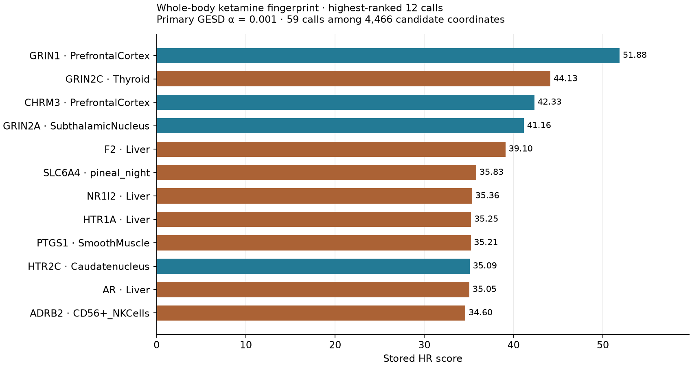
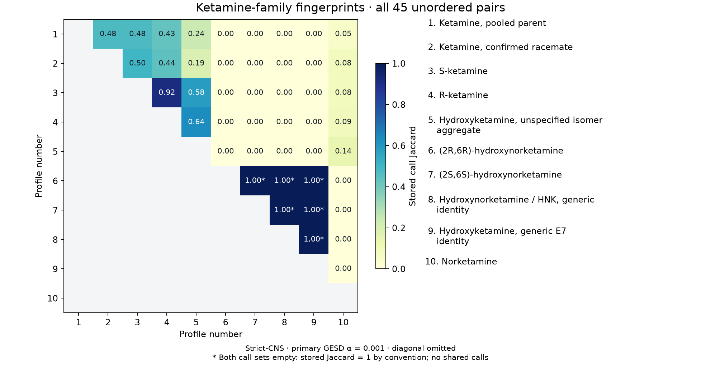
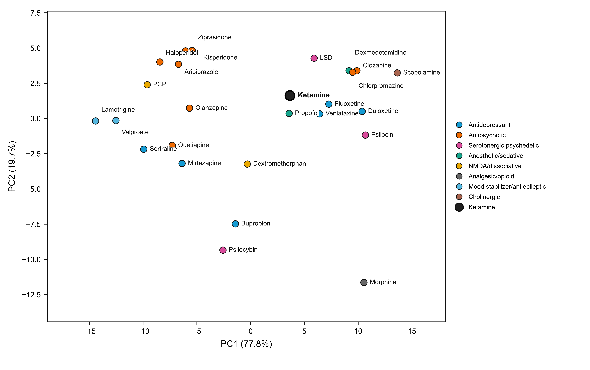

# Selected scientific results

These three figures present accepted public **v0.1.1** results. Two are new,
direct visualizations of retained result tables; the third is the original
accepted Figure 4. No HR scores, GESD calls, pairwise metrics, or multivariate
coordinates were recalculated. Figure provenance, source SHA-256 values, and
display selections are recorded in
[gallery_provenance.json](figures/gallery_provenance.json).

## Whole-body ketamine fingerprint

The twelve highest-ranked calls, in stored GESD rank order, illustrate the
whole-body fingerprint: **59 primary calls at α = 0.001** among 58 × 77 = 4,466
candidate coordinates. Bar lengths are the stored HR scores, not statistical
effect sizes. Teal identifies CNS tissue labels; brown identifies peripheral
or non-CNS tissue labels. The complete result is the retained
[whole-body primary call table](../results/reference/whole_body/KETAMINE_WHOLE_BODY_FINGERPRINT_ALPHA_0p001.csv).
The sensitivity analysis retains
[38 calls at α = 0.0001](../results/reference/whole_body/KETAMINE_WHOLE_BODY_FINGERPRINT_ALPHA_0p0001.csv).
This rank subset is a presentation choice, not a new threshold. A coordinate's
absence from the graphic is not evidence that it was tested and not called.

## Ketamine-family fingerprint comparisons

All **45 unordered pairs among 10 distinct family profiles** are shown using
stored strict-CNS primary fingerprint Jaccard values at **α = 0.001**. Each
cell is shared calls divided by the call-set union. The diagonal and lower
triangle are deliberately omitted. Full labels preserve pooled-parent,
confirmed-racemate, enantiomer, specified-isomer, and generic-profile distinctions.
For example, S-ketamine versus R-ketamine has 11 shared calls in a 12-call union
(Jaccard 0.9167). Support varies by profile; the separately stored jointly-tested
Jaccard may differ. Six pairs have two empty call sets: their stored Jaccard
is 1 by the implementation's empty-union convention, marked with an asterisk.
Those values do not mean shared fingerprint calls or demonstrated biological
similarity. Source: the accepted
[family pairwise result table](../results/reference/family/KETAMINE_FAMILY_ALL_PAIR_METRICS_FINAL.csv).

## External-drug context: frozen-reference PCA

This is the **unchanged accepted Figure 4**: 25 external reference drugs define
the fixed reference and pooled-parent Ketamine is projected without refitting
the axes. It displays exploratory continuous strict-CNS common-RHR coordinates,
**not a GESD fingerprint comparison**; an α threshold does not apply to this
panel. The retained axes are PC1 77.8% and PC2 19.7%.
The inherited EM-SVD reference fit reached its 300-iteration limit before
convergence; these remain qualified point estimates. Sources:
[validated figure coordinates](../results/reference/figure4/source_data/VALIDATED_FIGURE4_SOURCE_COORDINATES.csv),
[frozen reference scores](../results/reference/figure4/source_data/FROZEN_GLOBAL_FIXED_REFERENCE_PCA_SCORES.csv),
[numerical QC](../results/reference/figure4/qc/NUMERICAL_QC.json), and
[global model status](../results/reference/global/GLOBAL_MODEL_STATUS.csv).

## Provenance and interpretation

The figures use only individually retained, redistribution-approved public
reference outputs. Their covered data and adapted compilations use
[CC BY-SA 4.0 with the existing qualifications](../DATA_LICENSE.md);
original rendering code and prose use MIT. Re-render the two table views with
`python scripts/render_results_gallery.py` in the locked environment. The
command verifies five frozen source hashes before rendering, records every
plotted field/selection, and never writes to `results/reference/`.

The strict-CNS call tables and full HR-score matrices are excluded near-source
inputs; a new strict-CNS fingerprint plot is therefore not generated here.
No private-application figure was imported because its public release authority
would need separate verification. Synthetic notebook figures are educational
examples and are excluded from this scientific gallery.

HR relationships depend on their activity/expression inputs and candidate
universe. They do not establish tissue exposure, clinical efficacy, effect
direction, or causality. Fingerprint comparisons are the principal analyses;
continuous HR comparisons remain exploratory. See [methods](METHODS.md) and
[reproducibility](REPRODUCIBILITY.md).
